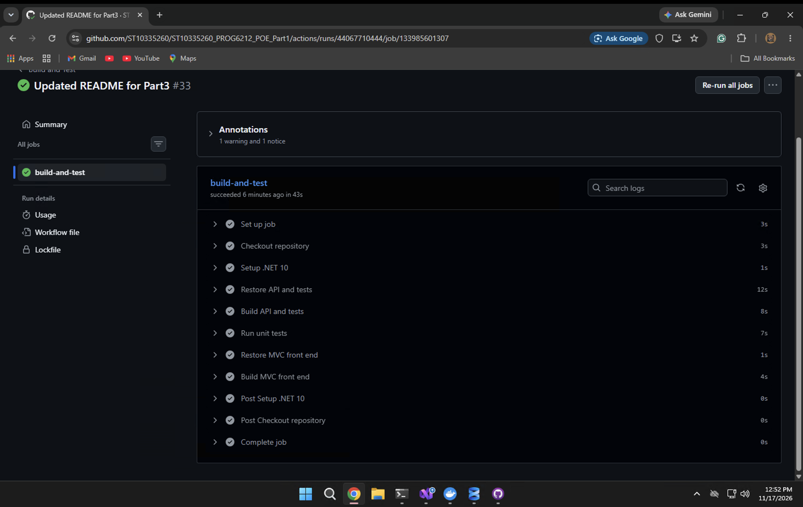

# RaceDay Event Management System

**Module:** PROG6212 Programming 2B | **Assessment:** POE Part 3 (MVC front end, Azure Blob storage with Azurite, Docker and CI)
**Student:** Reesaido Alagiry | **Student number:** ST10335260

## Contents

1. [Project description](#1-project-description)
2. [Technology stack](#2-technology-stack)
3. [Repository structure](#3-repository-structure)
4. [Run with Docker (one command)](#4-run-with-docker-one-command)
5. [Run locally in Visual Studio](#5-run-locally-in-visual-studio)
6. [Demo accounts and seed data](#6-demo-accounts-and-seed-data)
7. [User roles, authentication and navigation](#7-user-roles-authentication-and-navigation)
8. [Pages in the MVC application](#8-pages-in-the-mvc-application)
9. [Image storage with Azurite](#9-image-storage-with-azurite)
10. [API endpoints](#10-api-endpoints)
11. [Design decisions](#11-design-decisions)
12. [Unit tests](#12-unit-tests)
13. [Continuous integration](#13-continuous-integration)
14. [Video walkthrough](#14-video-walkthrough)
15. [Part 1 and Part 2 summary](#15-part-1-and-part-2-summary)
16. [Reference list](#16-reference-list)

## 1. Project description

RaceDay is an event management system for South African road running, walking and cycling events. Part 1 planned the system and built the SQL database design. Part 2 built the RESTful API. Part 3, documented here, adds an ASP.NET Core MVC web application that consumes that API, stores uploaded images in Azure Blob storage (emulated locally with Azurite), and packages everything in Docker containers.

There are two roles. Organisers create events, attach race categories, confirm enrolments and capture results. Participants browse and filter upcoming events, enter a category, manage their enrolments, view published results and keep a profile with a profile picture.

The MVC application contains no database code and no business rules. Every action calls the Web API over HTTP, and the API remains the single source of truth (Microsoft, 2026a).

## 2. Technology stack

| Area | Choice |
|---|---|
| Front end | ASP.NET Core MVC (Razor views) on .NET 10, Bootstrap 5.3 and Bootstrap Icons (Bootstrap, 2024) |
| API | ASP.NET Core Web API on .NET 10 (C#) |
| Data access | Entity Framework Core 10, Code-First with migrations (Microsoft, 2026c) |
| Database | SQL Server (local: SQL Server Express, Docker: SQL Server 2022 container) |
| Authentication | Server-side sessions; the MVC application forwards the API session cookie (Microsoft, 2026d) |
| Image storage | Azure Blob Storage through the `Azure.Storage.Blobs` SDK, emulated by Azurite (Microsoft, 2026e) |
| Containers | Docker and Docker Compose (Docker, 2026) |
| Unit testing | xUnit with the EF Core in-memory provider (xUnit.net, n.d.; Microsoft, 2023) |
| CI | GitHub Actions (GitHub, n.d.) |

## 3. Repository structure

```
ST10335260_PROG6212_POE_Part1/
|-- .github/workflows/
|   |-- build-and-test.yml                   CI: build API, run unit tests, build MVC
|   |-- validate-structure.yml               CI: check repository structure
|-- docs/                                    Planning files, screenshots, sample images
|-- ST10335260_PROG6212_POE_Part2/
|   |-- ST10335260_PROG6212_POE_Part2/       Web API project (with Dockerfile)
|   |-- ST10335260_PROG6212_POE_Part2.Tests/ xUnit test project
|   |-- ST10335260_PROG6212_POE_Part2.slnx   Solution (API, tests and MVC)
|-- ST10335260_PROG6212_POE_Part3/           MVC front end (with Dockerfile)
|   |-- Controllers/ Views/ Models/ Services/ Filters/ Helpers/ wwwroot/
|-- docker-compose.yml                       SQL Server, Azurite, API and MVC
|-- README.md
```

## 4. Run with Docker (one command)

Prerequisite: Docker Desktop is installed and running. From the repository root (the folder that contains `docker-compose.yml`), run:

```
docker compose up --build
```

The first build downloads images and can take several minutes. When the logs show that the API and web containers are listening, open:

| Service | Address |
|---|---|
| MVC web application | <http://localhost:8080> |
| Web API with Swagger UI | <http://localhost:5223/swagger> |
| Azurite blob endpoint | <http://localhost:10000/devstoreaccount1> |

The API applies the database migrations and seeds the demo data on start-up, so no manual database setup is needed. To stop the containers use `docker compose down`. To also remove the stored data use `docker compose down -v`.

## 5. Run locally in Visual Studio

1. Install Visual Studio with the ASP.NET and web development workload, the .NET 10 SDK, SQL Server Express and Node.js (for Azurite).
2. Start Azurite in a terminal: `npx azurite-blob --skipApiVersionCheck --loose`. Leave it running.
3. Open `ST10335260_PROG6212_POE_Part2/ST10335260_PROG6212_POE_Part2.slnx`.
4. Right-click the solution, choose **Configure Startup Projects**, select **Multiple startup projects** and set both `ST10335260_PROG6212_POE_Part2` (the API) and `ST10335260_PROG6212_POE_Part3` (the MVC application) to **Start**.
5. Press F5. The API listens on `http://localhost:5223` and the MVC application on `http://localhost:5290`. The MVC application reads the API address from `ApiSettings:BaseUrl` in its `appsettings.json`.
6. The API creates the `RaceDayApi` database on `localhost\SQLEXPRESS` and seeds the demo data on first start. To apply migrations manually, run `dotnet ef database update` in the API project folder.

## 6. Demo accounts and seed data

The three race categories (5km Fun Run, 10km Road Run and 21.1km Half Marathon) are created whenever the category table is empty. Optional demo data is created when `Seed:DemoData` is `true` (the Docker setup turns it on): four events (three upcoming and one finished with published results), enrolments and results. The application does not depend on this data. With an empty database every page shows a helpful empty state.

| Role | Email | Password |
|---|---|---|
| Organiser | organiser@raceday.demo | Password123! |
| Participant | thandi@raceday.demo | Password123! |
| Participant | sipho@raceday.demo | Password123! |

## 7. User roles, authentication and navigation

- Registration lets the person choose Participant or Organiser. Passwords are hashed with BCrypt in the API and never stored in plain text.
- After login the MVC application stores the user in its own session and forwards the API session cookie on every call. The MVC session cookie (`RaceDay.Web.Session`) has a different name from the API cookie so the two do not clash on `localhost`.
- A `SessionAuthorize` filter protects every private page (Microsoft, 2026b). A visitor who is not logged in is sent to the login page and returned to the requested page afterwards. A logged-in user of the wrong role sees an access denied page.
- The navigation bar is role based. Visitors see the public event list. Participants see Discover, My enrolments and My results. Organisers see Dashboard, Events, Categories, Enrolments and Results. Both roles have a profile menu with a log out button.
- Forms use anti-forgery tokens, input is validated on the server, and API errors are shown as friendly messages instead of raw error pages (Microsoft, 2026f).

## 8. Pages in the MVC application

**Public and participant**

| Page | Purpose |
|---|---|
| Home / Discover | Upcoming events with filters for search, location, type, distance and date |
| Event details | Description, facts, categories with entry fee and places left, enrol button, results for finished events |
| My enrolments | Entries with colour-coded status (green Confirmed, amber Pending, grey Cancelled), bib number and cancel |
| My results | Published finish time, pace and rank for finished events |
| Profile | Edit details and upload a profile picture |

**Organiser**

| Page | Purpose |
|---|---|
| Dashboard | Totals for events, upcoming events, enrolments, pending entries and published results |
| Events | Create, edit and delete events, including a banner image upload |
| Categories | Add categories to an event with fee and capacity, edit them, remove them, or create new categories |
| Enrolments | Filter by status, confirm or cancel entries |
| Results | Capture finish time and position per confirmed participant and publish them |

## 9. Image storage with Azurite

Event banners and profile pictures are uploaded from the browser to the MVC application, forwarded to the API, validated (JPG, PNG, WebP or GIF, at most 5 MB) and saved to the Azurite blob containers `event-banners` and `profile-pictures`. The public blob URL is stored in the database (`Events.BannerUrl` and `Users.ProfilePictureUrl`) and the MVC views render the image from that URL. Only the API talks to blob storage (Microsoft, 2026e).

Inside Docker the API connects to `azurite:10000` while the URL saved in the database uses `http://localhost:10000/devstoreaccount1`, which is the address the browser can reach. This is set with `BlobStorage:PublicBaseUrl`.

Ready-made sample images are in `docs/sample-images/` for use as banners and a profile picture.

## 10. API endpoints

Public endpoints need no login and return an empty list when there is nothing to show.

| Method | Endpoint | Access |
|---|---|---|
| POST | /api/auth/register | Public |
| POST | /api/auth/login | Public |
| POST | /api/auth/logout | Logged in |
| GET | /api/events (filters: search, location, type, minDistance, maxDistance, from, to, upcoming) | Public |
| GET | /api/events/{id} | Public |
| GET | /api/events/{id}/categories | Public |
| GET | /api/categories | Public |
| GET | /api/event-categories/{id}/results | Public (published only; Organiser sees all) |
| GET | /api/users/me | Logged in |
| PUT | /api/users/me | Logged in |
| POST | /api/users/me/profile-picture | Logged in |
| GET | /api/users/me/enrolments | Logged in (401 otherwise) |
| GET | /api/users/me/results | Logged in (401 otherwise) |
| POST | /api/event-categories/{id}/enrolments | Participant |
| DELETE | /api/enrolments/{id} | Participant |
| GET | /api/events/mine | Organiser |
| POST, PUT, DELETE | /api/events and /api/events/{id} | Organiser (owner) |
| POST | /api/events/{id}/banner | Organiser (owner) |
| GET | /api/events/{id}/enrolments | Organiser (owner) |
| POST | /api/categories | Organiser |
| POST | /api/events/{id}/categories | Organiser (owner) |
| PUT, DELETE | /api/event-categories/{id} | Organiser (owner) |
| GET | /api/event-categories/{id}/enrolments | Organiser (owner) |
| PUT | /api/enrolments/{id}/status | Organiser (owner) |
| POST | /api/results | Organiser |
| PUT | /api/results/{id} | Organiser |
| GET | /api/organiser/dashboard | Organiser |

## 11. Design decisions

- **Thin front end.** The MVC application only calls the API. It never touches the database, so the rules (capacity, duplicate entries, bib numbers, ownership) exist in one place.
- **Cookie forwarding.** The API uses session authentication, so the MVC application captures the API session cookie at login, keeps it in its own session and sends it with each request.
- **Enrolment workflow.** New enrolments start as Pending. The Organiser confirms them, which issues the next bib number for the event (starting at 1001). Results can only be captured for confirmed enrolments.
- **Published results.** The `Verified` flag acts as the published flag. Participants and the public only see published results.
- **Safe deletes.** Events, categories and enrolments that have dependent data return a 409 conflict with a clear message instead of failing.
- **Resilient start-up.** The API retries the database connection while SQL Server starts in Docker, then migrates and seeds.
- **Part 2 feedback addressed.** The status endpoint `PUT /api/enrolments/{id}/status`, a 401 for `users/me/enrolments` when not logged in, the `api/events/{id}/categories` route, non-nullable `Position` and `OverallRank`, a richer `PUT /api/results/{id}` and more unit tests.

## 12. Unit tests

The xUnit project in `ST10335260_PROG6212_POE_Part2/ST10335260_PROG6212_POE_Part2.Tests` contains 42 tests covering authentication, role enforcement, events, categories, enrolment workflow and results, using the EF Core in-memory provider. Run them from that folder with `dotnet test`.

## 13. Continuous integration

Two GitHub Actions workflows run on every push.

- **Validate Repository Structure** checks that the `docs` folder, the planning files, the README, the three project folders and the Docker files exist.
- **Build and Test** restores and builds the API and test project, runs the unit tests, then builds the MVC application.



## 14. Video walkthrough

Unlisted YouTube video: 

## 15. Part 1 and Part 2 summary

- ERD: [docs/RaceDay_ERD.png](docs/RaceDay_ERD.png)
- Endpoint plan: [docs/RaceDay_API_Endpoint_Plan.pdf](docs/RaceDay_API_Endpoint_Plan.pdf)
- SQL script: [docs/RaceDay_Database.sql](docs/RaceDay_Database.sql)
- Part 2 Swagger screenshot: [docs/Part2_Swagger.png](docs/Part2_Swagger.png)
- Part 1 video: <https://youtu.be/RxXAerIaFFw>
- Part 2 video: <https://youtu.be/-yi8OkdGL4E>

## 16. Reference list

Bootstrap (2024) *Bootstrap 5.3 documentation*. Available at: https://getbootstrap.com/docs/5.3/ (Accessed: 17 November 2026).

Docker (2026) *Docker Compose overview*. Available at: https://docs.docker.com/compose/ (Accessed: 17 November 2026).

GitHub (n.d.) *GitHub Actions documentation*. Available at: https://docs.github.com/en/actions (Accessed: 17 November 2026).

Microsoft (2023) *EF Core In-Memory Database Provider*. Available at: https://learn.microsoft.com/en-us/ef/core/providers/in-memory/ (Accessed: 17 November 2026).

Microsoft (2026a) *Overview of ASP.NET Core MVC*. Available at: https://learn.microsoft.com/en-us/aspnet/core/mvc/overview (Accessed: 17 November 2026).

Microsoft (2026b) *Filters in ASP.NET Core*. Available at: https://learn.microsoft.com/en-us/aspnet/core/mvc/controllers/filters (Accessed: 17 November 2026).

Microsoft (2026c) *Migrations Overview - EF Core*. Available at: https://learn.microsoft.com/en-us/ef/core/managing-schemas/migrations/ (Accessed: 17 November 2026).

Microsoft (2026d) *Session and state management in ASP.NET Core*. Available at: https://learn.microsoft.com/en-us/aspnet/core/fundamentals/app-state (Accessed: 17 November 2026).

Microsoft (2026e) *Use the Azurite emulator for local Azure Storage development*. Available at: https://learn.microsoft.com/en-us/azure/storage/common/storage-use-azurite (Accessed: 17 November 2026).

Microsoft (2026f) *Prevent Cross-Site Request Forgery (XSRF/CSRF) attacks in ASP.NET Core*. Available at: https://learn.microsoft.com/en-us/aspnet/core/security/anti-request-forgery (Accessed: 17 November 2026).

xUnit.net (n.d.) *xUnit.net*. Available at: https://xunit.net/ (Accessed: 17 November 2026).
