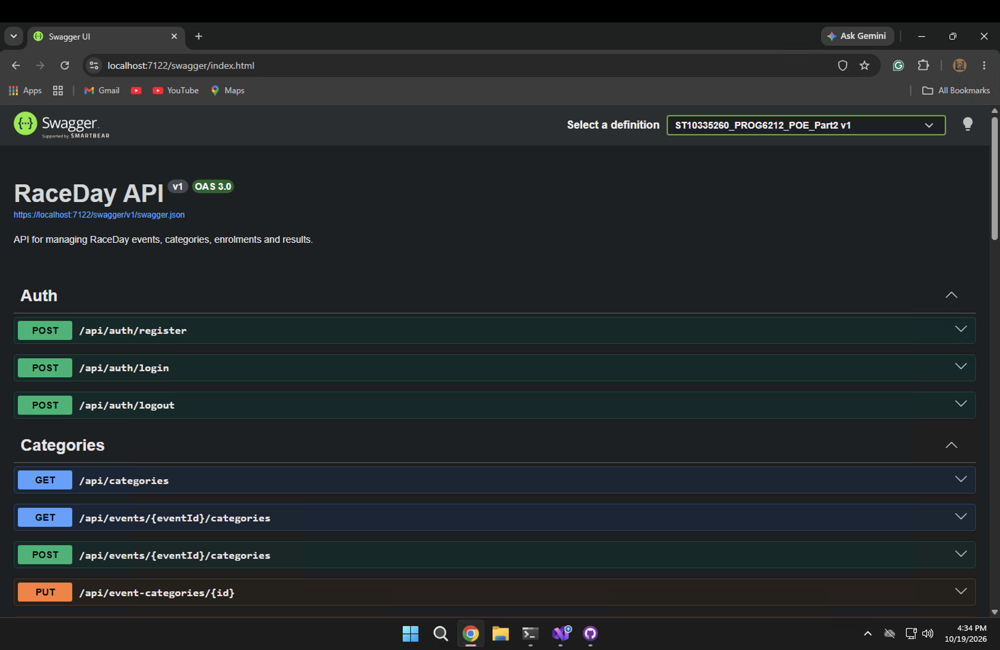
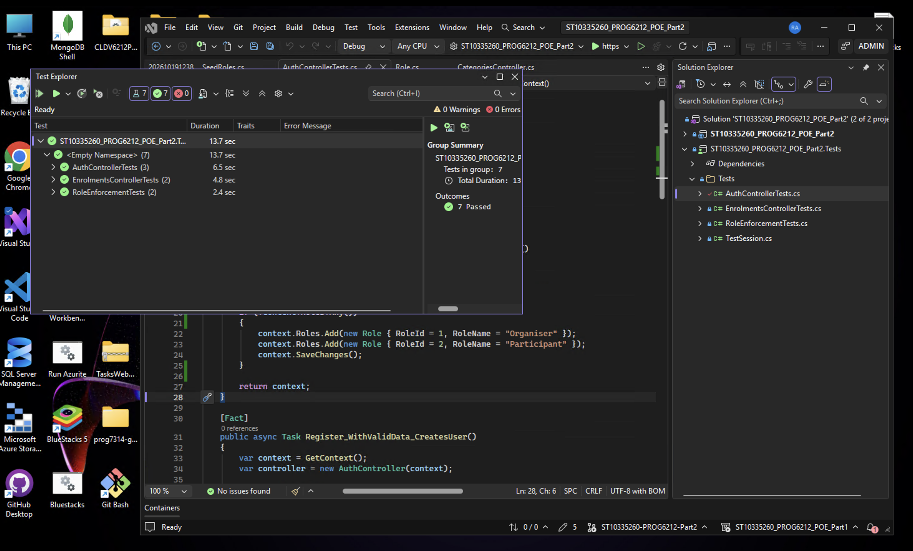
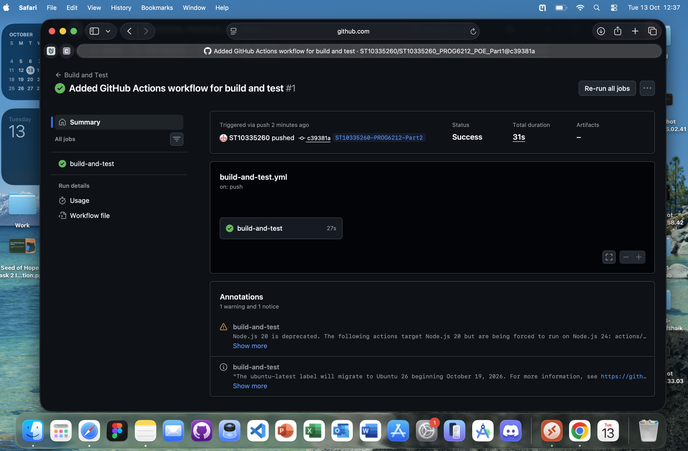

# RaceDay Event Management System

**Module:** PROG6212 Programming 2B | **Assessment:** POE Part 2 (RESTful API Development)
**Student:** Reesaido Alagiry | **Student number:** ST10335260

## Contents

1. [Project description](#1-project-description)
2. [Technology stack](#2-technology-stack)
3. [Repository structure](#3-repository-structure)
4. [Setup and run instructions](#4-setup-and-run-instructions)
5. [User roles and authentication](#5-user-roles-and-authentication)
6. [API endpoints](#6-api-endpoints)
7. [Example requests](#7-example-requests)
8. [Design decisions](#8-design-decisions)
9. [Unit tests](#9-unit-tests)
10. [Continuous integration](#10-continuous-integration)
11. [Video walkthrough](#11-video-walkthrough)
12. [Part 1 summary](#12-part-1-summary)
13. [Reference list](#13-reference-list)

## 1. Project description

RaceDay is an event management system for South African road running, walking and cycling events. Part 1 planned the system and built the SQL database. Part 2, documented here, is the working RESTful API built on that design.

Event Organisers create and manage events, attach race categories (for example 5km or 10km) to an event, and capture results. Participants browse events, enrol in a category, receive a bib number and view their own enrolments and results. The API follows the conventions for ASP.NET Core web APIs, using attribute-routed controllers with the `[ApiController]` attribute (Microsoft, 2026a).



## 2. Technology stack

| Area | Choice |
|---|---|
| Framework | ASP.NET Core Web API on .NET 10 (C#) |
| Data access | Entity Framework Core 10, Code-First with migrations (Microsoft, 2026d) |
| Database | SQL Server Express (`localhost\SQLEXPRESS`), database `RaceDayApi` |
| Authentication | Session based, with role checks in authorization filters (Microsoft, 2026c; Microsoft, 2026e) |
| Password hashing | BCrypt.Net-Next 4.2.0 (McKee, Emerl and Miller, n.d.) |
| API documentation | Swashbuckle (Swagger UI) with XML comments (Microsoft, 2025) |
| Unit testing | xUnit with the EF Core in-memory provider (xUnit.net, n.d.; Microsoft, 2023) |
| CI | GitHub Actions (GitHub, n.d.) |

## 3. Repository structure

```
ST10335260_PROG6212_POE_Part1/
|-- .github/workflows/
|   |-- build-and-test.yml            Part 2 CI: build and run unit tests
|   |-- validate-structure.yml        Part 1 CI: check planning files exist
|-- docs/                             Part 1 planning files and screenshots
|-- ST10335260_PROG6212_POE_Part2/
|   |-- ST10335260_PROG6212_POE_Part2/          The API project
|   |   |-- Controllers/                Auth, Users, Events, Categories, Enrolments, Results
|   |   |-- Data/                       RaceDayDbContext
|   |   |-- DTOs/                       Register and login requests
|   |   |-- Filters/                    RequireAuth and RequireRole attributes
|   |   |-- Migrations/                 EF Core migrations
|   |   |-- Models/                     Entities
|   |   |-- Services/                   PasswordHasher
|   |   |-- Program.cs
|   |   |-- appsettings.json
|   |-- ST10335260_PROG6212_POE_Part2.Tests/    xUnit test project
|-- README.md
```

## 4. Setup and run instructions

### Prerequisites

- .NET 10 SDK
- SQL Server Express running as `localhost\SQLEXPRESS` (SQL Server Management Studio is optional)
- Visual Studio 2022 or later, or the .NET command line
- EF Core command line tool, if you are not using Visual Studio: `dotnet tool install --global dotnet-ef`

### Steps

1. **Clone the repository**

   ```
   git clone https://github.com/ST10335260/ST10335260_PROG6212_POE_Part1.git
   cd ST10335260_PROG6212_POE_Part1/ST10335260_PROG6212_POE_Part2/ST10335260_PROG6212_POE_Part2
   ```

2. **Check the connection string** in `appsettings.json`. The default uses Windows authentication on SQL Server Express:

   ```
   Server=localhost\SQLEXPRESS;Database=RaceDayApi;Trusted_Connection=True;TrustServerCertificate=True;
   ```

   Change the server name if your instance is named differently.

3. **Create the database.** From the API project folder run:

   ```
   dotnet ef database update
   ```

   In Visual Studio, use Package Manager Console instead, with the API project as the default project: `Update-Database`. This creates the `RaceDayApi` database with all 8 tables and seeds the two roles, Organiser and Participant (Microsoft, 2026b).

4. **Add the reference categories.** The API reads categories but does not create them, so insert them once in SQL Server Management Studio, with `RaceDayApi` selected:

   ```sql
   INSERT INTO Categories (CategoryName, Description, DefaultDistance, CreatedAt)
   VALUES
   ('5km Fun Run', 'Beginner friendly 5km', 5, GETUTCDATE()),
   ('10km Road Run', 'Standard 10km road race', 10, GETUTCDATE()),
   ('21.1km Half Marathon', 'Half marathon distance', 21.1, GETUTCDATE());
   ```

5. **Run the API**

   ```
   dotnet dev-certs https --trust
   dotnet run --launch-profile https
   ```

   In Visual Studio, choose the `https` profile and press F5.

6. **Open Swagger UI** at <https://localhost:7122/swagger>. Swagger is enabled in the Development environment only. Log in through Swagger and the browser keeps the session cookie, so later requests in the same tab are authenticated.

7. **Run the unit tests.** From the `ST10335260_PROG6212_POE_Part2.Tests` folder:

   ```
   dotnet test
   ```

## 5. User roles and authentication

| | Organiser | Participant |
|---|---|---|
| Purpose | Creates and manages events, categories and results | Browses events, enrols and views own data |
| Create, update, delete events | Yes (own events only for update and delete) | No (403) |
| Attach or change categories on an event | Yes | No (403) |
| Capture and update results | Yes | No (403) |
| View enrolments for a category | Yes | No (403) |
| Enrol in or cancel an enrolment | No (403) | Yes (own enrolments only) |
| View own profile, enrolments and results | Yes | Yes |
| Browse events, categories and leaderboards | Yes | Yes |

**How authentication works**

- A user registers with a role (`Organiser` or `Participant`). The password is hashed with BCrypt before it is stored, and the plain text password is never saved.
- On login the API stores the user id and role in the server-side session. The session cookie is HttpOnly and expires after 30 minutes of inactivity (Microsoft, 2026e).
- Two custom authorization filters protect endpoints. `RequireAuth` rejects requests with no session. `RequireRole("Organiser")` and `RequireRole("Participant")` also check the role. Filters run before the action method, so a rejected request never reaches the controller code (Microsoft, 2026c).
- Status codes follow HTTP semantics (Fielding, Nottingham and Reschke, 2022): `401` not logged in, `403` logged in with the wrong role, `404` not found, `409` conflict such as a duplicate email or enrolment.

## 6. API endpoints

**Auth**

| Method | Route | Access | Result |
|---|---|---|---|
| POST | `/api/auth/register` | Public | 201, or 409 if the email exists, 400 if the role is invalid |
| POST | `/api/auth/login` | Public | 200, or 401 for wrong credentials |
| POST | `/api/auth/logout` | Public | 200, clears the session |

**Users**

| Method | Route | Access | Result |
|---|---|---|---|
| GET | `/api/users/me` | Logged in | Own profile |
| PUT | `/api/users/me` | Logged in | Update own profile |

**Events**

| Method | Route | Access | Result |
|---|---|---|---|
| GET | `/api/events` | Public | List of active events |
| GET | `/api/events/{id}` | Public | One event, or 404 |
| POST | `/api/events` | Organiser | 201, owner set from the session |
| PUT | `/api/events/{id}` | Organiser (owner) | 200, or 403 if not the owner |
| DELETE | `/api/events/{id}` | Organiser (owner) | 204, or 403 if not the owner |

**Categories**

| Method | Route | Access | Result |
|---|---|---|---|
| GET | `/api/categories` | Public | All categories |
| GET | `/api/events/{eventId}/categories` | Public | Categories attached to an event |
| POST | `/api/events/{eventId}/categories` | Organiser | 201, sets entry fee and participant limit |
| PUT | `/api/event-categories/{id}` | Organiser | 200, updates fee and limit |
| DELETE | `/api/event-categories/{id}` | Organiser | 204 |

**Enrolments**

| Method | Route | Access | Result |
|---|---|---|---|
| POST | `/api/event-categories/{id}/enrolments` | Participant | 201 with a bib number, or 409 if already enrolled or full |
| GET | `/api/users/me/enrolments` | Logged in | Own enrolments |
| GET | `/api/event-categories/{id}/enrolments` | Organiser | Enrolments for a category |
| DELETE | `/api/enrolments/{id}` | Participant (owner) | 204, or 403 if not the owner |

**Results**

| Method | Route | Access | Result |
|---|---|---|---|
| POST | `/api/results` | Organiser | 201 |
| GET | `/api/event-categories/{id}/results` | Public | Leaderboard ordered by position |
| GET | `/api/users/me/results` | Logged in | Own results |
| PUT | `/api/results/{id}` | Organiser | 200, updates finish time and position |

## 7. Example requests

**Register** (`POST /api/auth/register`)

```json
{
  "email": "organiser@test.com",
  "password": "Test1234",
  "firstName": "Olivia",
  "lastName": "Organiser",
  "dateOfBirth": "1990-03-02T00:00:00Z",
  "role": "Organiser"
}
```

**Create an event** (`POST /api/events`, logged in as an Organiser). `eventType` is a number: 0 Run, 1 Walk, 2 Cycle.

```json
{
  "eventName": "Cape Town Fun Run 2026",
  "description": "Scenic 10km road run along the Sea Point promenade",
  "eventDate": "2026-12-05T06:30:00Z",
  "location": "Sea Point, Cape Town",
  "distanceKm": 10,
  "eventType": 0,
  "isActive": true
}
```

**Attach a category** (`POST /api/events/1/categories`)

```json
{
  "categoryId": 2,
  "entryFee": 150,
  "maxParticipants": 100
}
```

## 8. Design decisions

- **EventType added to Events.** The Part 2 brief requires each event to be a run, walk or cycle, which was not in the Part 1 ERD. The `Events` entity therefore has an `EventType` field (an enumeration with Run, Walk and Cycle). This is a deliberate change from the Part 1 design, and the Part 1 `RaceDay` database was left untouched.
- **Separate database.** The API uses a new database, `RaceDayApi`, created entirely by EF Core migrations, so the schema in the code and the database always match (Microsoft, 2026d).
- **Seeded roles.** The Organiser and Participant roles are seeded through the migration, so a new database can register users without manual SQL (Microsoft, 2026b).
- **Restricted cascade deletes.** SQL Server rejected the first migration because deleting an event or user could reach enrolments through more than one path (error 1785, multiple cascade paths). The foreign keys on enrolments and the event organiser use restricted deletes, so records are not removed silently (Microsoft, 2021).
- **Business rules in the API.** Enrolment checks for a duplicate enrolment and for a full category, and then assigns a bib number. A unique index on participant and event category also enforces the duplicate rule in the database.
- **Ownership checks.** An Organiser can only update or delete their own events, and a Participant can only cancel their own enrolments.

**Known limitations**

- Categories are inserted with SQL because the plan did not include an endpoint to create them.
- Sessions are held in server memory, so users must log in again after the API restarts.

## 9. Unit tests

The test project uses xUnit with the EF Core in-memory provider, so the tests run without SQL Server (xUnit.net, n.d.; Microsoft, 2023). A small fake session class lets the controllers and filters be tested without a running web server.

| Test class | What it checks |
|---|---|
| `AuthControllerTests` | Valid registration creates a user, a duplicate email returns a conflict, a wrong password returns unauthorized |
| `RoleEnforcementTests` | A Participant is rejected with 403 on an Organiser-only action, and a request with no session is rejected as unauthorized |
| `EnrolmentsControllerTests` | Enrolling in a full category and enrolling twice both return a conflict |

All 7 tests pass:



## 10. Continuous integration

The workflow `.github/workflows/build-and-test.yml` runs on every push and on pull requests to `main`. It sets up the .NET SDK, restores packages, builds the test project (which builds the API project too) and runs all unit tests (GitHub, n.d.).



## 11. Video walkthrough

Unlisted YouTube video showing the API running in Swagger UI, the two roles, the role checks, and the code structure: <https://youtu.be/-yi8OkdGL4E>

## 12. Part 1 summary

Part 1 covered the planning and the SQL database design: the ERD with 8 entities, the API endpoint plan and the SQL script.

- ERD: [docs/RaceDay_ERD.png](docs/RaceDay_ERD.png)
- Endpoint plan: [docs/RaceDay_API_Endpoint_Plan.pdf](docs/RaceDay_API_Endpoint_Plan.pdf)
- SQL script: [docs/RaceDay_Database.sql](docs/RaceDay_Database.sql)
- Part 1 CI screenshot: [docs/RaceDay_ci_build_success.png](docs/RaceDay_ci_build_success.png)
- Part 1 video: <https://youtu.be/RxXAerIaFFw>

## 13. Reference list

Fielding, R., Nottingham, M. and Reschke, J. (eds.) (2022) *RFC 9110: HTTP Semantics*. Available at: https://www.rfc-editor.org/rfc/rfc9110 (Accessed: 19 October 2026).

GitHub (n.d.) *GitHub Actions documentation*. Available at: https://docs.github.com/en/actions (Accessed: 19 October 2026).

McKee, C., Emerl, R.D. and Miller, D. (n.d.) *BCrypt.Net-Next* (Version 4.2.0) [NuGet package]. Available at: https://www.nuget.org/packages/BCrypt.Net-Next (Accessed: 19 October 2026).

Microsoft (2021) *Cascade Delete - EF Core*. Available at: https://learn.microsoft.com/en-us/ef/core/saving/cascade-delete (Accessed: 19 October 2026).

Microsoft (2023) *EF Core In-Memory Database Provider*. Available at: https://learn.microsoft.com/en-us/ef/core/providers/in-memory/ (Accessed: 19 October 2026).

Microsoft (2025) *Get started with Swashbuckle and ASP.NET Core*. Available at: https://learn.microsoft.com/en-us/aspnet/core/tutorials/getting-started-with-swashbuckle (Accessed: 19 October 2026).

Microsoft (2026a) *Create web APIs with ASP.NET Core*. Available at: https://learn.microsoft.com/en-us/aspnet/core/web-api/ (Accessed: 19 October 2026).

Microsoft (2026b) *Data Seeding - EF Core*. Available at: https://learn.microsoft.com/en-us/ef/core/modeling/data-seeding (Accessed: 19 October 2026).

Microsoft (2026c) *Filters in ASP.NET Core*. Available at: https://learn.microsoft.com/en-us/aspnet/core/mvc/controllers/filters (Accessed: 19 October 2026).

Microsoft (2026d) *Migrations Overview - EF Core*. Available at: https://learn.microsoft.com/en-us/ef/core/managing-schemas/migrations/ (Accessed: 19 October 2026).

Microsoft (2026e) *Session in ASP.NET Core*. Available at: https://learn.microsoft.com/en-us/aspnet/core/fundamentals/app-state (Accessed: 19 October 2026).

xUnit.net (n.d.) *xUnit.net*. Available at: https://xunit.net/ (Accessed: 19 October 2026).
